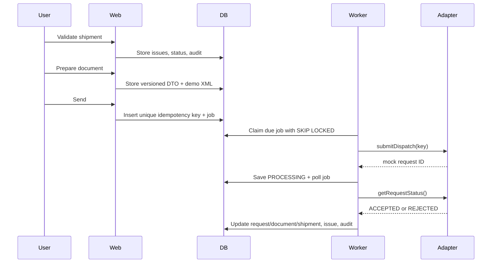

# Architecture

## Layers

- `src/app`: authenticated route handlers and server-rendered operational pages
- `src/components`: UI and client interactions
- `src/domain`: pure validation, mapping, status transitions, retry classification, idempotency
- `src/services`: shipment/import transactions and tenant-scoped data access
- `src/db`: Drizzle schema and PostgreSQL connection
- `src/integrations`: eOtpremnica, SEF, and source adapter contracts
- `src/jobs`: durable PostgreSQL queue and worker
- `src/i18n`: Serbian Latin, English, and optional Russian UI copy

Every business table has `organization_id`; reads and writes include the actor's organization. A second seeded organization supports isolation tests. Route handlers enforce role permissions on the server. Cross-tenant detail requests return 404. An operational database role with row-level security would be an appropriate next defense layer.

## Submission sequence

The mock adapter never calls an external government endpoint. `integration_requests` has a unique `(organization_id,idempotency_key)` index. The key hashes organization, shipment, operation, document version, and canonical payload. The worker atomically claims jobs with `FOR UPDATE SKIP LOCKED` and conditionally claims request state before calling the adapter. Transient failures schedule a new PostgreSQL job with exponential backoff. Authentication and validation failures are not automatically retried. Old `integration_events` and audit records remain.

## State transitions

`DRAFT → IMPORTED → NEEDS_DATA or READY → QUEUED → SUBMITTING → SUBMITTED → ACCEPTED`.

Branches: `SUBMITTING/SUBMITTED → FAILED_TRANSIENT → QUEUED`, `SUBMITTING/SUBMITTED → REJECTED → NEEDS_DATA/READY` after correction, and `ACCEPTED → DELIVERED`. Unsent shipments can be cancelled and audited. Cancellation through an official adapter is not implemented. `src/domain/status.ts` rejects invalid direct transitions. The database constrains status values.

## Queue and recovery

The queue lives in `jobs`. One worker loop claims due jobs, records attempts, and writes a `worker_heartbeats` row. `/api/ready` checks that heartbeat. A worker recovers jobs whose RUNNING lease is older than two minutes. Before horizontal scaling or real government use, add request reconciliation and verify upstream idempotency to handle a crash after the external service accepted a request.

## Data and retention

Operational shipments, payloads, exceptions, and append-only audit events have different retention needs. Determine retention with counsel and customers before production use; no Serbian legal retention conclusion is encoded here. Personal data is minimized to names, work email, customer business names, and shipment destinations. Demo data uses fictional companies and invalid tax identifiers.
